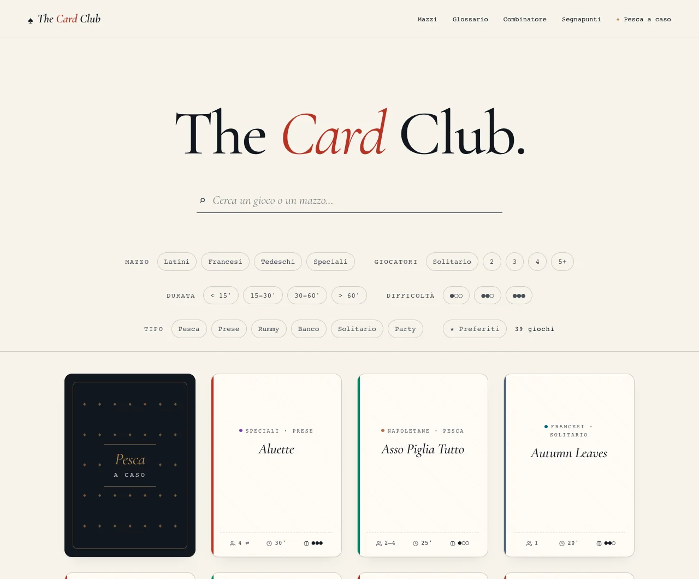

# The Card Club

Archivio di regole di giochi di carte (napoletane, francesi, tedesche e mazzi speciali), in italiano.
Online su [thecardclub.netlify.app](https://thecardclub.netlify.app).



- Catalogo con ricerca, filtri e preferiti
- Regole con tavolo virtuale, stampa e condivisione
- Segnapunti, con la partita salvata nel browser
- Glossario, schede dei mazzi e Combinatore (propone un gioco in base a giocatori, tempo e difficoltà)
- PWA installabile: home e regole sono disponibili offline

## Sviluppo

Next.js (App Router) e React, con export statico. Servono pnpm e Node.js 22.18 o successivo (`pnpm test` esegue TypeScript senza compilarlo).

```bash
pnpm install
pnpm dev       # http://localhost:3000, senza service worker
pnpm build     # export statico in out/
pnpm start     # serve out/ in locale (dopo pnpm build)
pnpm test      # test con node:test
pnpm lint      # Biome; pnpm lint:fix per correggere
```

`dev` e `build` usano webpack (`--webpack`) perché `@ducanh2912/next-pwa` non supporta Turbopack.

Questa versione di Next.js ha cambiamenti incompatibili con le precedenti: prima di scrivere codice leggi [AGENTS.md](AGENTS.md).

## Struttura

| Percorso | Contenuto |
| --- | --- |
| `src/app/` | Pagine, stili globali, sitemap, robots, pagina offline |
| `src/components/` | Catalogo, card, finestre (glossario, mazzi, Combinatore, segnapunti) |
| `src/lib/` | Lettura dei dati, formattazione, salvataggio del segnapunti |
| `src/data/games.json` | Catalogo dei giochi (metadati, filtri, tavolo virtuale, punteggio) |
| `src/data/rules/<id>.md` | Regole di ogni gioco |
| `src/data/glossary.json`, `src/data/mazzi.json` | Glossario e schede dei mazzi |
| `public/images/decks/*.webp` | Copertine dei mazzi, usate anche come immagini Open Graph |

## Aggiungere un gioco

1. Aggiungi una voce a `src/data/games.json`. I campi sono descritti dal tipo `Game` in `src/types/index.ts`.
2. Crea `src/data/rules/<id>.md` con lo stesso `id`. La fonte di riferimento è [pagat.com](https://www.pagat.com).
3. Se vuoi, aggiungi `scoring` alla voce: `categories` crea una riga del segnapunti per ogni categoria, `winTarget` indica i punti per vincere.

Pagina, sitemap e disponibilità offline si generano al build.

## Offline

Il service worker (`public/sw.js`) è generato a ogni build e non è versionato. `next.config.mjs` mette in cache la home e tutte le regole, ricavate da `games.json`. A ogni deploy chi ha l'app riscarica queste pagine (circa 1,2 MB), perché l'HTML punta a file il cui nome cambia con il build.

In `pnpm dev` il service worker è disattivato: per provarlo in locale usa `pnpm build && pnpm start`.

## Dati salvati nel browser

Non c'è un backend. Tutto resta nel `localStorage` dell'utente:

- `carte.favorites.v1`: preferiti
- `carte.scoreboard.v1.<id>`: partita in corso per gioco (`generic` per il segnapunti della home)

## Deploy

Netlify pubblica `out/` secondo `netlify.toml`. I push su `main` vanno in produzione, le pull request generano una deploy preview.

Variabili d'ambiente, tutte opzionali:

- `NEXT_PUBLIC_SITE_URL`: URL pubblico per canonical, sitemap e Open Graph (predefinito `https://thecardclub.netlify.app`)
- `NEXT_PUBLIC_CF_BEACON_TOKEN`: attiva Cloudflare Web Analytics
